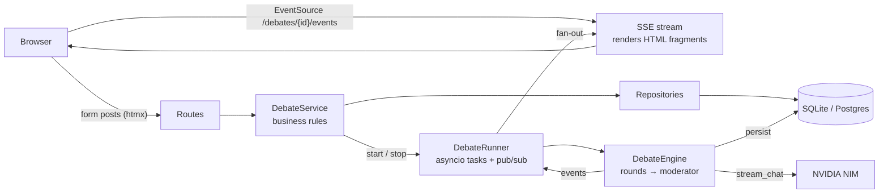

# Debate Council

Put your requirements on trial before you write code.

Describe a feature or project, pick a council of AI specialists (Business Analyst, Senior Developer, DevOps Engineer, Frontend Engineer, Product Owner, Data Engineer) and watch them debate it **live**, round by round. When the final round ends, a neutral moderator writes a decision-ready report: verdict, agreed requirements, open questions, risks and next steps.

Models are served by **NVIDIA NIM** through its OpenAI-compatible API.


| Live debate | Finished debate (dark mode) |
|---|---|
|  |  |

## Quick start

```bash
python -m venv .venv && source .venv/bin/activate
pip install -e ".[dev]"
cp env.example .env          # then set NVIDIA_API_KEY=nvapi-... in .env
python -m app.main           # http://localhost:8000
```

On startup the app applies database migrations and seeds the six council agents, so there is no separate setup step. Register an account, click **New debate**, and you're running.

Get an API key from [build.nvidia.com](https://build.nvidia.com). Keep it in `.env` (git-ignored) and never commit it.

### Docker

```bash
docker build -t debate-council .
docker run -p 8000:8000 --env-file .env debate-council
```

### Management CLI

```bash
python -m app.cli migrate        # apply migrations
python -m app.cli seed-agents    # add any missing council agents
python -m app.cli list-agents
python -m app.cli create-admin   # prompts for username, email, password
```

## Configuration

All settings come from environment variables or `.env` (see `env.example`).

| Variable | Default | Notes |
|---|---|---|
| `NVIDIA_API_KEY` | — | **Required to run debates.** |
| `LLM_MODEL` | `meta/llama-3.3-70b-instruct` | Any chat model in the NIM catalog. |
| `NVIDIA_BASE_URL` | `https://integrate.api.nvidia.com/v1` | Point at a self-hosted NIM if you have one. |
| `LLM_TEMPERATURE` / `LLM_MAX_TOKENS` / `LLM_SUMMARY_MAX_TOKENS` | `0.7` / `450` / `1200` | Per-turn and report length limits. |
| `DATABASE_URI` | `sqlite:///database.db` | Postgres works too (`postgresql://...`). |
| `SECRET_KEY` | random in dev | **Required in production.** Signs JWTs and sessions. |
| `ENV` | `development` | `production` enables secure cookies and hides `/docs`. |
| `MAX_CONCURRENT_DEBATES` | `4` | Debates beyond this wait in a queue. |
| `AUTO_MIGRATE` | `true` | Run migrations + seeding at startup. |

## How it works



1. **Create.** `POST /debates` validates the request (topic length, at least 2 agents, 1-5 rounds, provider configured), stores the debate and its participants, and hands it to the `DebateRunner`.
2. **Run.** The runner starts the `DebateEngine` as a background asyncio task. For each round, every participant speaks in order. Their prompt contains the topic, the transcript so far and round-specific instructions: open with a position, then rebut, then converge in the final round. After the last round, the moderator streams the report.
3. **Stream.** The engine publishes events (`MessageStarted`, `TokenDelta`, `MessageCompleted`, `SummaryDelta`, …). Token deltas are batched to about 15 updates per second. The SSE endpoint turns each event into small HTML fragments with `hx-swap-oob`, and the [htmx SSE extension](https://htmx.org/extensions/sse/) patches them into the page. No client-side framework is involved.
4. **Persist.** Messages are written as they stream (partial content is saved every second), so stopping a debate keeps everything said so far. On a restart, debates left running are marked as interrupted.

**Reconnects are lossless.** When a browser connects or reconnects, the server subscribes it to events and renders a snapshot in the same synchronous step, with no `await` between them, so no token can fall between the two. You can refresh mid-debate and pick up exactly where you were.

### Project layout

```
app/
  llm/            LLM client protocol + NVIDIA NIM implementation
  services/       debate_service (rules), debate_engine (orchestration),
                  debate_runner (background tasks + pub/sub), prompts, auth
  repositories/   data access (debates, agents, users)
  models/         SQLModel tables
  schemas/        request/response models for the JSON API
  routers/        HTML pages (htmx) and JSON API (/api)
  web/            Jinja environment, markdown rendering, SSE fragment stream
  templates/      layouts, pages and partials (debates/_*.html are live regions)
  static/         design system (css/app.css), small JS, vendored htmx
migrations/       Alembic migrations
tests/            pytest suite (uses a scripted fake LLM; no network)
```

## JSON API

Every page is backed by the same service layer that the API uses. Authenticate with the login cookie, or exchange credentials for a bearer token:

```bash
TOKEN=$(curl -s -X POST localhost:8000/api/auth/token -d "username=alice&password=..." | jq -r .access_token)
curl -H "Authorization: Bearer $TOKEN" -H "Content-Type: application/json" \
     -d '{"topic":"A booking app for study rooms","agent_ids":[1,2,5],"max_rounds":2}' \
     localhost:8000/api/debates
```

| Method | Path | |
|---|---|---|
| `POST` | `/api/auth/token` | Username/password → bearer token |
| `GET` | `/api/agents` | Council members |
| `GET` / `POST` | `/api/debates` | List (`?q=&status=`) / create and start |
| `GET` | `/api/debates/{id}` | Debate with participants, messages, report |
| `POST` | `/api/debates/{id}/stop` | Stop a running debate |
| `DELETE` | `/api/debates/{id}` | Delete |
| `GET` | `/api/users` | Admin only |

Interactive docs are at `/docs` when `ENV=development`.

## Development

```bash
pytest            # 29 tests, ~5s, no network needed
ruff check . && ruff format --check .
alembic revision --autogenerate -m "describe change"   # after changing models
```

The tests drive the real engine, runner, SSE stream and pages with a scripted `FakeLLM` (`tests/fakes.py`). The NIM client is tested against a mocked HTTP transport.

## Design decisions and limits

- **Server-rendered UI with htmx.** There's no JS build step, and pages work without JavaScript; only live streaming needs it. Model output is rendered as markdown with raw HTML disabled, so a model can't inject markup.
- **Live state is held in process.** That is why the server runs with **one worker**. To scale out, replace `DebateRunner`'s queues with Redis pub/sub and run the engine in a worker process. The service and engine interfaces don't need to change.
- **Security.** Passwords are hashed with Argon2. JWT cookies are HttpOnly and `SameSite=Lax`, and `Secure` in production. Debates are scoped to their owner, login redirects reject off-site URLs, and the admin pages and API are role-gated.
